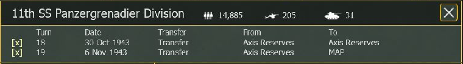

# 德国预备队解锁与调动日程

从西欧、意大利和巴尔干移入预备队、且原有明确调动日程的单位如下。日期按每回合七天折算。

下图是普通版德军第 2 回合的实机画面。第 11 SS 师在第 18 回合仍留在预备队，第 19 回合调上地图。

## 第 5 回合（1943-07-31）

- 355th Infantry Division（转入地图）

## 第 13 回合（1943-09-25）

- 1st Panzer Division（转入地图）
- 36th Pz Rgt Flammpanzer Company（转入地图）
- 24th Pz Rgt Flammpanzer Battalion（转入地图）
- 389th Infantry Division（转入地图）
- 279th Stug Battalion（转入地图）
- 280th Stug Battalion（转入地图）
- I./TG 1（转入地图）

## 第 15 回合（1943-10-09）

- 278th Stug Battalion（转入地图）

## 第 17 回合（1943-10-23）

- I/53rd LW Mot. Mixed Flak Battalion（转入地图）

## 第 19 回合（1943-11-06）

- 11th SS Panzergrenadier Division（转入地图）
- 103rd SS SS Mot. Werfer Battalion（转入地图）
- 2nd Fallschirmjaeger Division（转入地图）
- 281st Stug Battalion（转入地图）
- III SS Panzer Corps（转入地图）

## 第 23 回合（1943-12-04）

- Netherlands SS Grenadier Regiment（转入地图）
- 286th Stug Battalion（转入地图）
- 300th Stug Battalion（转入地图）

## 第 31 回合（1944-01-29）

- I/57th Mot. Werfer Battalion（转入地图）
- II/57th Mot. Werfer Battalion（转入地图）

## 第 35 回合（1944-02-26）

- 100th Jaeger Division（转入地图）
- 8th Construction Battalion（转入地图）

## 第 36 回合（1944-03-04）

- 311th Stug Battalion（转入地图）

## 第 39 回合（1944-03-25）

- 367th Infantry Division（转入地图）

## 第 40 回合（1944-04-01）

- 325th Stug Battalion（转入地图）

## 第 43 回合（1944-04-22）

- 17th Coastal Fortress Construction Battalion（转入地图）

## 第 66 回合（1944-09-30）

- 201st Stug Battalion（转入地图）

## 第 67 回合（1944-10-07）

- Rhodos Sturm Division（转入地图）
- Stab/FAGr 5（转入地图）

## 第 71 回合（1944-11-04）

- LXVIII zbV Corps（转入地图）
- 1st Mountain Division（转入地图）
- II/12th LW Mot. Mixed Flak Battalion（转入地图）

## 第 76 回合（1944-12-09）

- IX SS Mountain Corps（转入地图）

## 第 79 回合（1944-12-30）

- 13th SS Mountain Division（转入地图）
- 92nd Mot. Sturm Brigade（转入地图）

## 第 80 回合（1945-01-06）

- 118th Jaeger Division（转入地图）

## 第 82 回合（1945-01-20）

- 356th Infantry Division（转入地图）
- 715th Static Infantry Division（转入地图）
- V SS Mountain Corps（转入地图）
- 105th SS Panzer Battalion（转入地图）
- 105th SS leFH Howitzer Battalion（转入地图）

## 第 83 回合（1945-01-27）

- 141st LW Flak Regiment（在预备队解除限制）
- I./NJG 7（转入地图）

## 第 92 回合（1945-03-31）

- 117th Jaeger Division（转入地图）

## 第 94 回合（1945-04-14）

- XC Corps（转入地图）
